# ProPodcast

A podcast app for Android, built with Jetpack Compose and Material 3 on top of the
[Listen Notes API](https://www.listennotes.com/api/). Browse the best podcasts by genre and region, search,
keep favorites, download episodes for offline listening and play them in the background, on phones and tablets.

<p>
  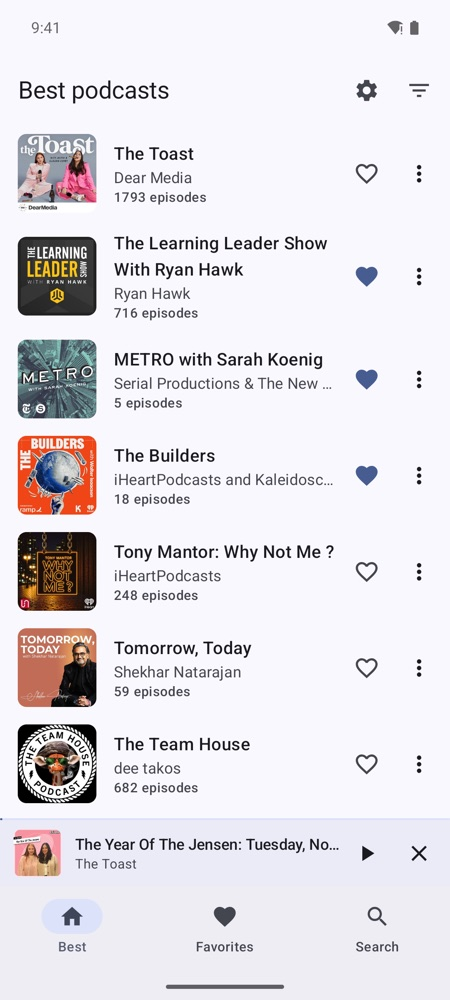
  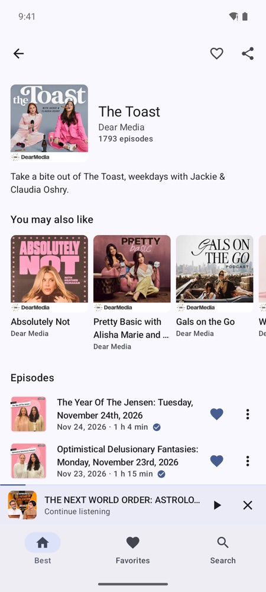
  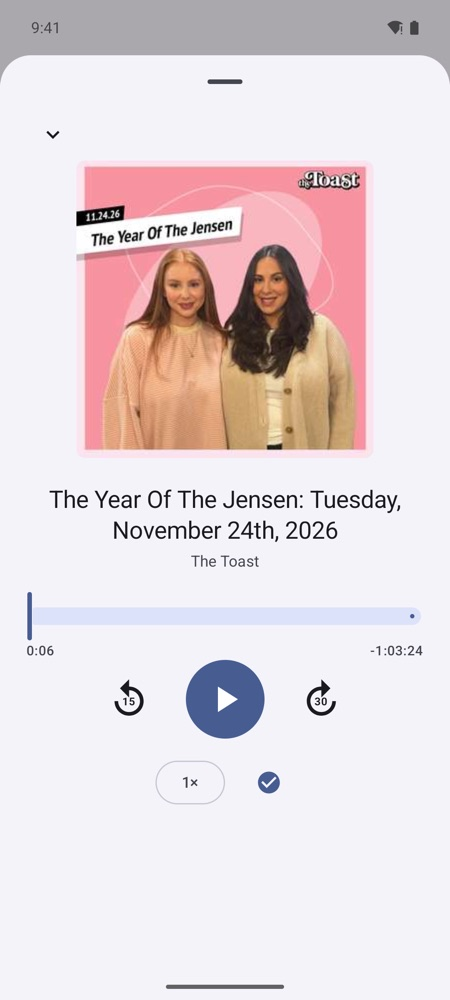
  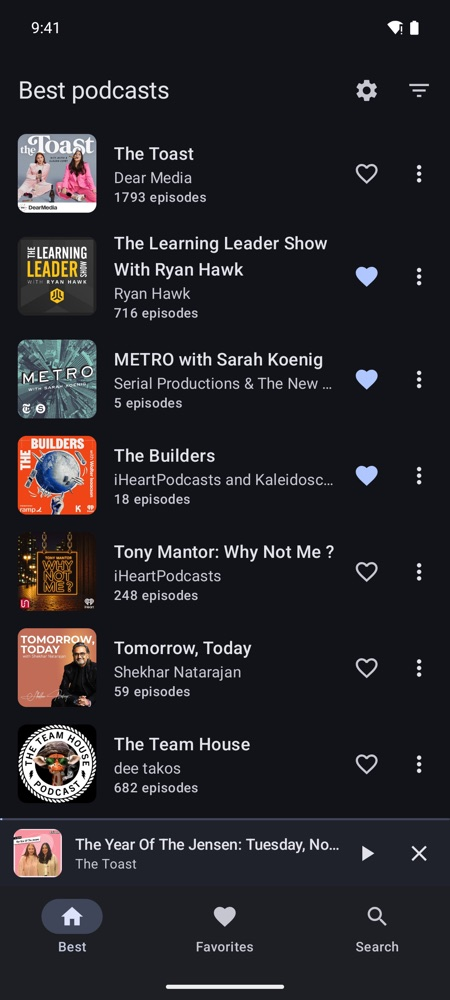
</p>

## Features

**Discover**
- **Best podcasts** — an endless, paged list of the best podcasts, filtered by genre and region in a bottom
  sheet. Active filters show as chips that hide while you scroll down and come back when you scroll up.
- **Search** — podcasts by keyword, with an optional language filter.
- **Podcast details** — artwork, description ("Show more"), a "You may also like" carousel and the episode list.
  The artwork flies from the list into the details (shared-element transition).
- **Share** a podcast or an episode by link.

**Favorites**
- Favorite podcasts and episodes, stored on the device (Room).
- Tabs: Podcasts, Episodes, Downloaded. Remove with the heart or a swipe, with **Undo** in a snackbar.

**Downloads and offline**
- Download episodes for offline listening (WorkManager). Progress, cancel (✕ or swipe) and retry (↻) in the
  Downloaded tab; a status mark next to every episode in any list.
- On mobile data the app asks first and shows the episode size; the **Download only on Wi-Fi** setting makes
  downloads wait for Wi-Fi instead.
- The player switches to the local file as soon as a download finishes, so playback keeps going offline.
- A thin red strip at the bottom shows when the device is offline, and a green one shows for 3 s when the
  connection is back. With no network and no data, Best offers a "Go to downloads" button.
- Genres and regions are cached, so the filters work offline too.

**Player** (Media3)
- Background playback with a media notification, lock-screen and Bluetooth controls, and audio focus.
- Mini player above the navigation bar; it expands into a full-screen player sheet (drag down or tap the scrim
  to close) with an animated artwork transition.
- Seek bar, −15 s / +30 s, playback speed (0.75×–2×), download from the player.
- Remembers the last episode and position, and offers to continue listening after a restart.

**Home screen widget** (Glance) — the current episode with play / pause, opens the app on tap.

**Settings**
- Theme: same as device, light or dark, with an animated color change.
- Download only on Wi-Fi.

**Adaptive layout**
- Navigation bar on phones; a navigation rail on tablets and in phone landscape.
- Lists become grids on wide screens; podcast details split into two panes (info and episodes) from 840 dp.
- The full player puts the artwork and the controls side by side in landscape.
- Material You dynamic colors on Android 12+, light and dark themes.

**Other**
- A banner warns when the Listen Notes API quota is running low.
- Firebase Crashlytics and Analytics (only when `google-services.json` is present).
- Debug builds talk to the Listen Notes mock server, so no API key is needed to run the app.

## Demo

| Phone | Tablet |
|:---:|:---:|
|  | 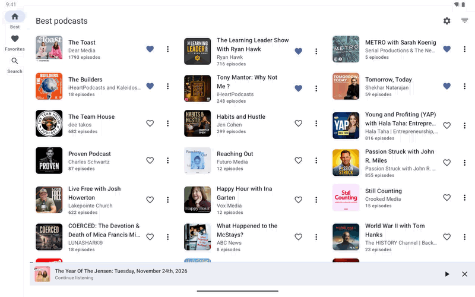 |

Best podcasts → podcast details (artwork transition) → play an episode → full-screen player → Favorites.
On the tablet the same flow uses the navigation rail, the grid, two-pane details and the landscape player.

## Screenshots

### Phone

| Best podcasts | Filters | Search | Podcast details |
|:---:|:---:|:---:|:---:|
|  | 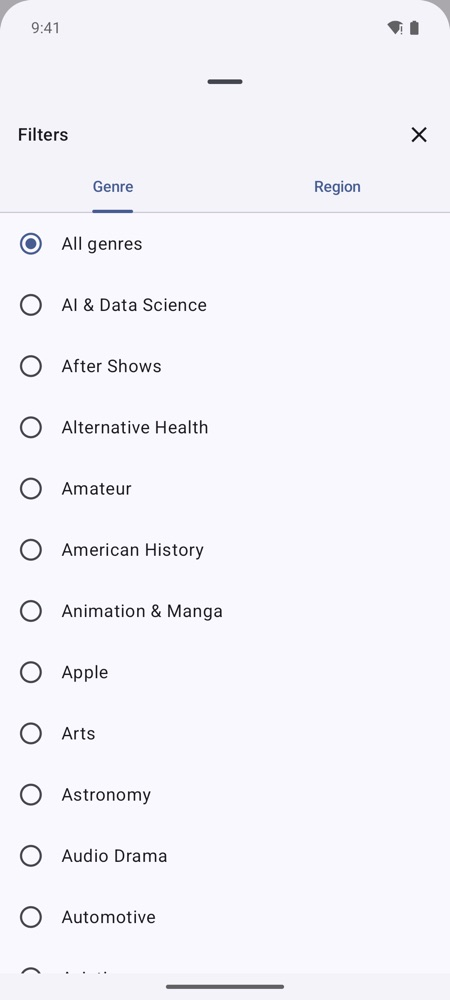 | 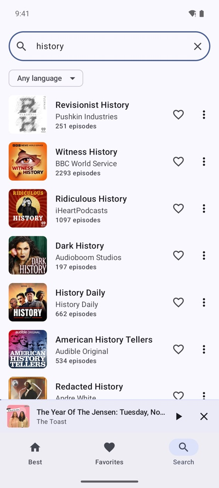 |  |

| Player | Favorites | Downloaded | Settings |
|:---:|:---:|:---:|:---:|
|  | 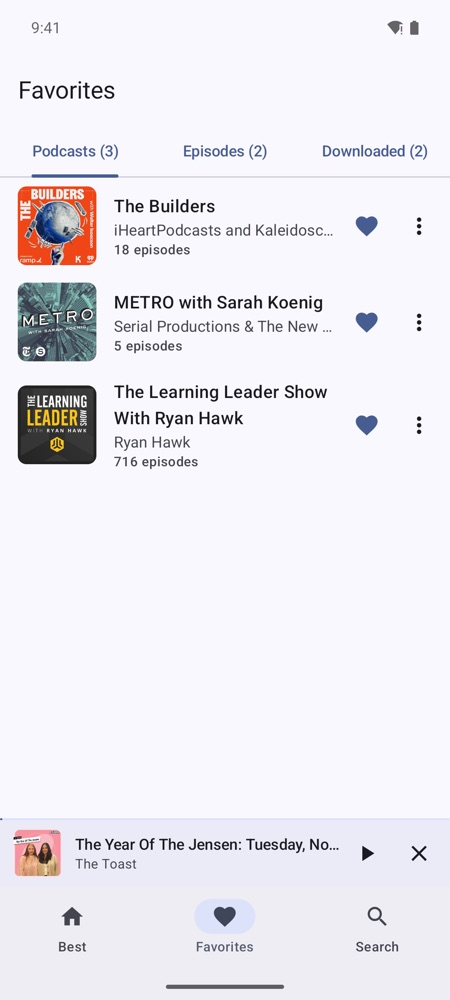 | 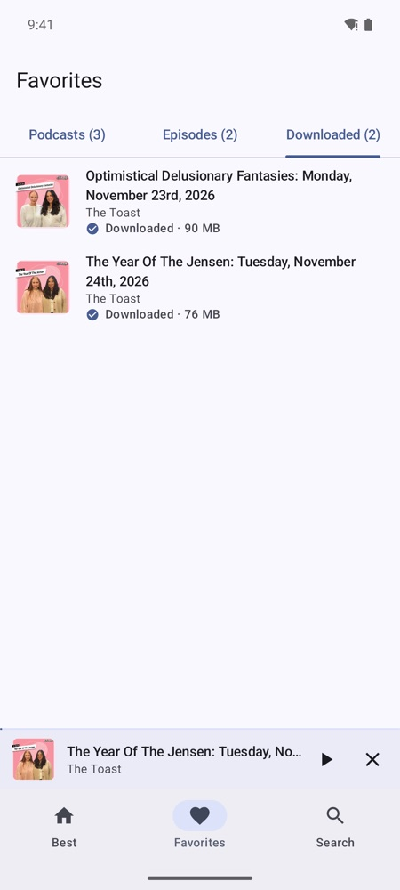 | 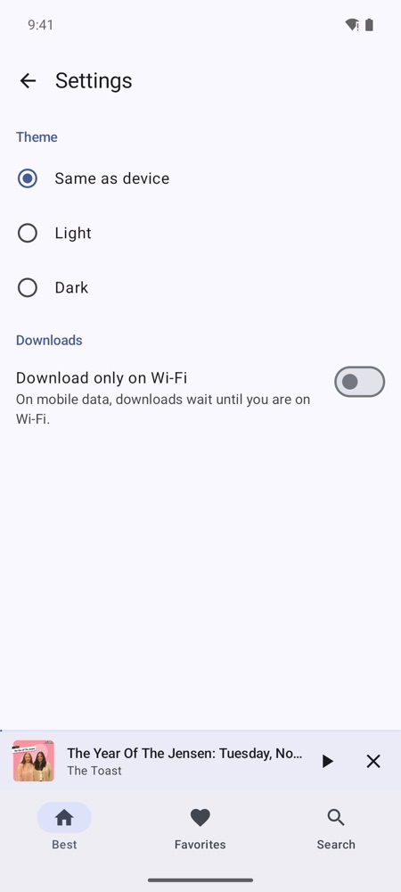 |

| Dark theme | Dark theme: details |
|:---:|:---:|
|  | 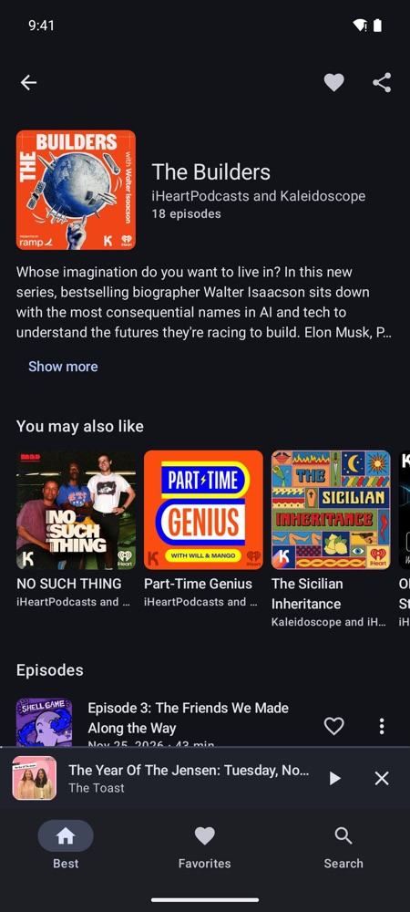 |

### Tablet

Best podcasts in three columns with a navigation rail:

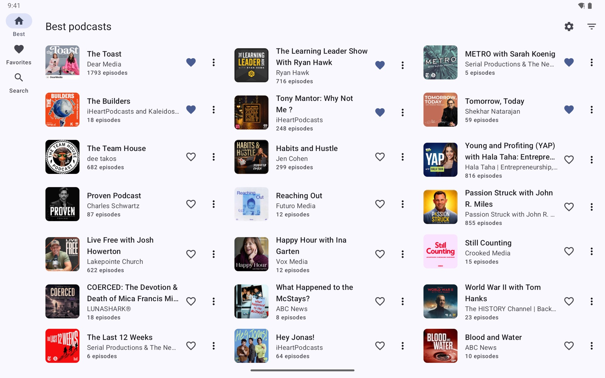

Podcast details in two panes:

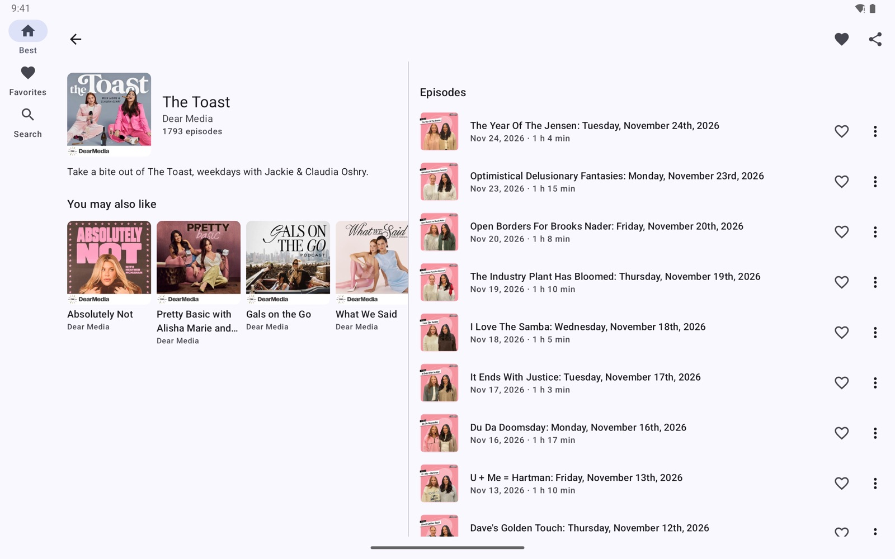

Full-screen player in landscape:

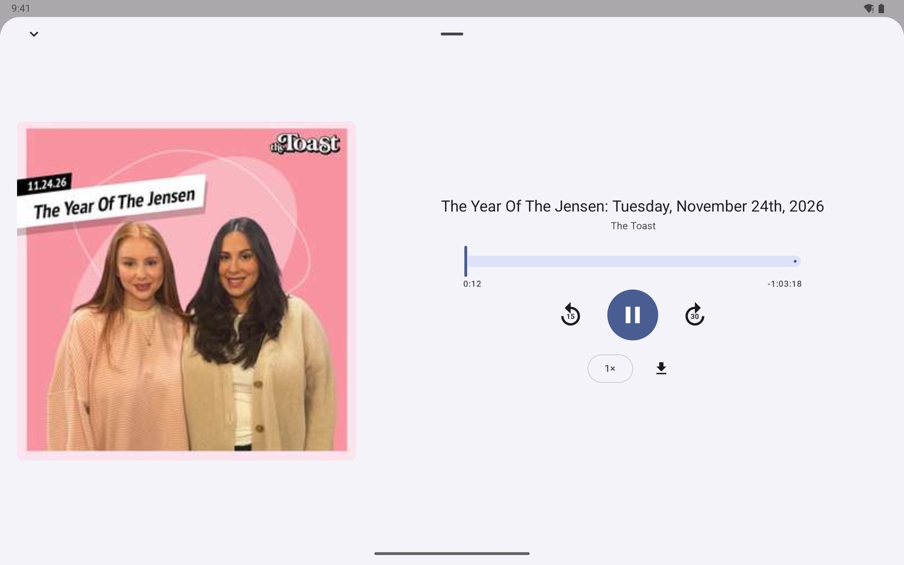

Favorites as a grid:

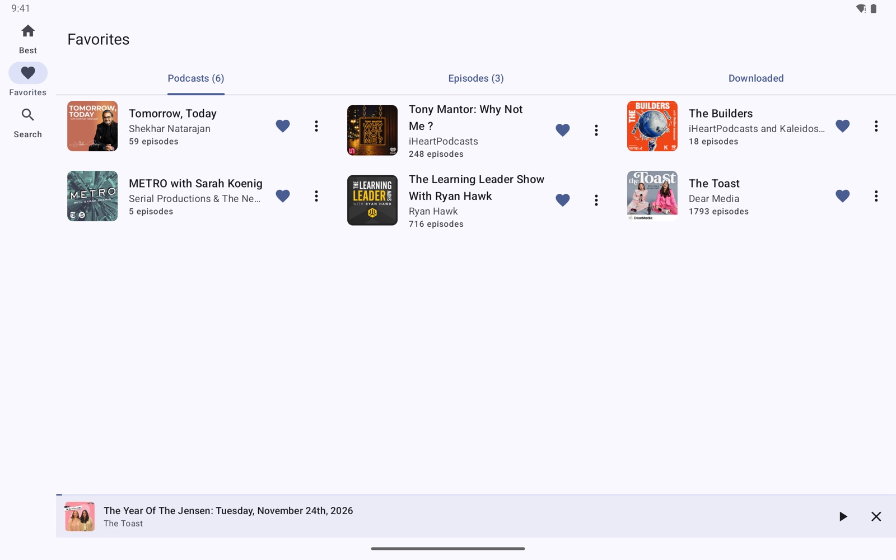

Portrait, two columns:

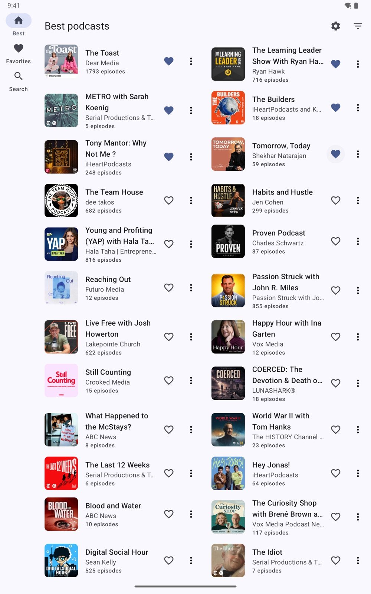

## Architecture

Single-activity app, MVVM with unidirectional data flow: Compose screens observe `StateFlow` UI state from
Hilt `ViewModel`s, which talk to repositories. Each screen has a stateless `…Content` composable that the UI
tests use directly.

```
app/src/main/kotlin/com/propodcast/app/
├── core/
│   ├── network/        Retrofit API, DTOs, API key and quota interceptors
│   ├── database/       Room: favorites and downloads (entities, DAOs, mappers)
│   ├── data/           repositories (podcasts, favorites, downloads, preferences, reference data)
│   ├── player/         Media3 service and PlayerController
│   ├── download/       WorkManager episode download worker
│   ├── connectivity/   network state (ConnectivityManager)
│   ├── designsystem/   theme, colors, typography
│   ├── commonwidgets/  shared composables (list items, artwork, buttons)
│   ├── analytics/ crash/  Firebase wrappers (no-op without Firebase)
│   └── model/ common/ ui/ di/
├── feature/            home, search, details, favorites, downloads, filters, player, settings, network
├── navigation/         type-safe routes and NavHost
└── widget/             Glance home screen widget
```

## Dependencies

| Library | Version | What it is used for |
|---|---|---|
| **Build** | | |
| Android Gradle Plugin | 9.5.3 | Builds the app; R8 shrinking for release |
| Kotlin | 2.4.21 | Language; Compose compiler and serialization plugins |
| KSP | 2.3.14 | Annotation processing for Hilt and Room |
| **UI** | | |
| Compose BOM | 2026.11.01 | Keeps all Compose libraries on matching versions |
| Compose UI, Material 3 | from BOM | The whole UI, Material You theming, shared-element transitions |
| Material 3 Adaptive Navigation Suite | from BOM | Switches between bottom bar and navigation rail by window size |
| Material Icons Core | from BOM | Icons |
| Activity Compose | 1.13.0 | `setContent`, edge-to-edge, permission requests |
| Navigation Compose | 2.10.2 | Type-safe navigation between screens |
| Lifecycle (runtime, ViewModel Compose) | 2.11.1 | ViewModels, lifecycle-aware `collectAsStateWithLifecycle` |
| Core KTX | 1.19.1 | Kotlin extensions for the Android framework |
| Coil 3 (compose, network-okhttp) | 3.6.3 | Loading and caching artwork over HTTP |
| **Dependency injection** | | |
| Hilt | 2.60.1 | Dependency injection across the app |
| Hilt Navigation Compose | 1.4.0 | `hiltViewModel()` in composables |
| Hilt Work | 1.4.0 | Injection into WorkManager workers |
| **Network** | | |
| Retrofit | 3.0.0 | Listen Notes REST API client |
| Retrofit kotlinx-serialization converter | 3.0.0 | JSON ↔ DTOs |
| OkHttp, logging interceptor | 5.5.1 | HTTP client, API key header, API quota tracking, request logs in debug |
| kotlinx.serialization JSON | 1.13.0 | JSON parsing, type-safe navigation routes |
| **Data** | | |
| Room | 2.8.5 | Local database: favorite podcasts and episodes, downloads |
| DataStore Preferences | 1.3.0 | Settings, filters, last played episode, cached genres and regions |
| Paging 3 (runtime, compose) | 3.5.3 | Endless lists of best podcasts and search results |
| WorkManager | 2.12.0 | Episode downloads that survive app restarts, Wi-Fi-only constraint |
| **Media** | | |
| Media3 ExoPlayer | 1.11.1 | Audio playback (stream or local file) |
| Media3 Session | 1.11.1 | Background service, media notification, lock-screen and Bluetooth controls |
| kotlinx-coroutines-guava | 1.11.0 | `await()` on Media3's `ListenableFuture`s |
| Glance AppWidget, Glance Material 3 | 1.2.0 | Home screen player widget in Compose style |
| **Monitoring** | | |
| Firebase BOM: Crashlytics, Analytics | 35.2.0 | Crash reports and screen / event analytics |
| Google Services plugin, Crashlytics plugin | 4.6.0, 3.0.8 | Reads `google-services.json`, uploads R8 mapping |
| Timber | 5.0.1 | Logging; in release, logs go to Crashlytics |
| **Tests** | | |
| JUnit 4, AndroidX JUnit | 4.13.2, 1.3.0 | Test runner |
| kotlinx-coroutines-test | 1.11.0 | Test dispatchers, `runTest` |
| Turbine | 1.2.1 | Testing `Flow`s |
| MockWebServer (OkHttp) | 5.5.1 | API tests against fake HTTP responses |
| Robolectric | 4.18.1 | JVM tests that need Android (Glance widget, WorkManager, DataStore) |
| WorkManager testing, Paging testing, Room testing, Glance testing | — | Test helpers for those libraries |
| Compose UI Test, Espresso | from BOM, 3.7.0 | Instrumented UI tests of the screens |

## Build and run

Requirements: JDK 17, Android SDK with platform 37.2. Min SDK 26, target SDK 37.

```bash
./gradlew :app:installDebug
```

The debug build uses the Listen Notes **mock server** with fake data and needs no setup.

Optional settings in `local.properties` (not in git):

```properties
# Production API key (used by release builds)
LISTEN_NOTES_API_KEY=your_key
# Debug builds use the production API instead of the mock server
LISTEN_NOTES_USE_PRODUCTION=true
```

**Firebase** (optional): put your `google-services.json` into `app/`. Without it the app builds and runs
without Crashlytics and Analytics.

**Release signing** (optional): create `keystore.properties` in the project root (not in git):

```properties
storeFile=keystore/release.jks
storePassword=...
keyAlias=...
keyPassword=...
```

Without it `assembleRelease` produces an unsigned APK.

## Tests

```bash
./gradlew :app:testDebugUnitTest            # unit tests (JVM, Robolectric)
./gradlew :app:connectedDebugAndroidTest    # UI and Room tests on a device or emulator
```
